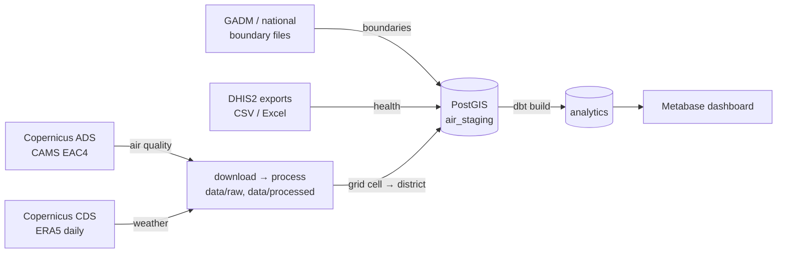

# Gaia GIS data warehouse: air quality, weather and health

Automated, reproducible pipeline that builds a **PostgreSQL/PostGIS data
warehouse** of district-level **air quality (CAMS EAC4)**, **weather (ERA5)** and
**health (DHIS2)** for African countries, plus the **dbt analytics models**
behind the working group's Metabase dashboard.

Countries configured: **Cameroon, Senegal, Malawi, Uganda, Ethiopia**. Adding a
country takes one YAML file (see [docs/adding_a_country.md](docs/adding_a_country.md)).



## What it does

| Stage | What it does |
|---|---|
| **boundaries** | Makes sure the country's districts exist in `air_staging.admin_unit`. Existing districts are reused, so IDs linked to health data never change. Missing ones are loaded from GADM 4.1 (downloaded automatically) or a national boundary file. |
| **download / process / load** (air quality) | CAMS EAC4 per country and month: PM2.5, PM10, O₃, NO₂, NO, SO₂, NOx. Units are converted to µg/m³ from the NetCDF metadata; gases use air density computed from surface pressure and temperature. Each 0.75° grid cell is mapped to the district containing it. Districts with no cell centre inside take their nearest cell. |
| **weather** | ERA5 daily means per country and month: temperature, relative humidity, wind speed and direction, precipitation. Mapped to districts the same way, on the 0.25° grid. |
| **health** | Loads each country's DHIS2 export (CSV/Excel, one column per indicator), maps health districts to admin units with a versioned mapping file, and sums districts that share an admin unit. Blank cells are skipped. Re-loading replaces the file's months and never duplicates them. |
| **dbt** | Rebuilds the `analytics` models used by Metabase and runs the data tests. |

Every step is **incremental and idempotent**: files already downloaded are
reused, months already loaded are skipped (`--incremental`), unchanged health
files are skipped, and inserts never duplicate. Every stage writes to
`air_staging.pipeline_run_log`.

## Quick start

Requirements: Python 3.9+, PostgreSQL 15 with PostGIS 3, and a free ECMWF
account for the [Atmosphere Data Store](https://ads.atmosphere.copernicus.eu) and
the [Climate Data Store](https://cds.climate.copernicus.eu). The same token
works for both. Accept the licences for *CAMS global reanalysis (EAC4)* and
*ERA5 post-processed daily statistics* on their dataset pages.

```powershell
git clone <this repository>
cd <repository folder>
python -m venv .venv
.venv\Scripts\activate          # Linux/macOS: source .venv/bin/activate
python -m pip install --upgrade pip
pip install -e .                 # installs the `gaia` command and all dependencies

copy .env.example .env           # then edit: AIR_DB_PASSWORD, ADS_API_KEY, GAIA_HEALTH_DATA_DIR
```

**New, empty database:** `gaia init-db` creates the schema.

```powershell
gaia countries                                   # what is configured
gaia run --country cameroon --start 2024-01 --end 2024-12
gaia run --all --incremental                     # everything not loaded yet
gaia run --all --incremental --dry-run           # preview, changes nothing
gaia status                                      # coverage per country / pollutant
```

`gaia` is the same as `python -m gaia_pipeline` (with `src` on `PYTHONPATH`).

## Commands

| Command | Purpose |
|---|---|
| `gaia run --country X [--country Y] \| --all` | All stages, then `dbt build` if anything new was loaded |
| `gaia boundaries\|download\|process\|load\|weather\|health --country X` | One stage only |
| `--start YYYY-MM --end YYYY-MM` | Period (default: `period` in the country file) |
| `--incremental` | Start after the last month already in the warehouse |
| `--stages download,process` | Run only some stages within `run` |
| `--dry-run` | Show what would run; changes nothing |
| `--overwrite` | Re-download and re-process files that already exist |
| `--refresh` | Overwrite existing fact rows / reload unchanged health files |
| `--skip-dbt` | Do not run dbt at the end of `run` |
| `gaia dbt [build\|run\|test\|docs generate …]` | Run dbt with the repository profile |
| `gaia status` | Rows, districts and date range per country, level and pollutant |
| `gaia init-db` | Create the warehouse schema in an empty database |

Logs go to `logs/gaia_YYYYMMDD.log`. Air quality and weather data end on
`copernicus.available_until` and `era5.available_until` in `config/settings.yml`.
ERA5's "latest" is computed automatically. Update the CAMS date when ECMWF
publishes a new EAC4 year (about once a year).

To try dbt changes without touching the tables the dashboard reads, set
`AIR_DBT_SCHEMA=analytics_dev`.

## Automation

`scripts/run_update.ps1` runs `gaia run --all --incremental`. Register it with
Windows Task Scheduler (default: every 4 weeks):

```powershell
powershell -ExecutionPolicy Bypass -File scripts\register_windows_task.ps1
```

On Linux, use cron with `scripts/run_update.sh`. Each scheduled run fetches
new CAMS and ERA5 months, reloads any health export that changed, and rebuilds
the dbt models.

## dbt models (`analytics` schema)

| Model | Grain | Notes |
|---|---|---|
| `district_daily_pm25`, `district_monthly_pm25`, `country_daily_pm25`, `country_pollution_rankings` | PM2.5 | Original dashboard models, columns unchanged, all countries |
| `district_monthly_health_pm25` | district × month × health indicator | Every country with health data (was Malawi only); adds indicator code and name |
| `district_daily_air_quality`, `district_monthly_air_quality` | district × day/month × pollutant | Every pollutant; monthly includes the ratio to the WHO annual guideline |
| `district_daily_who_exceedance` | district × day × pollutant | WHO 2021 24 h (8 h for O₃) guidelines |
| `country_monthly_air_quality` | country × month × pollutant | Includes % of district-days above the WHO guideline |
| `district_monthly_weather` | district × month | Temperature (mean/min/max), humidity, wind, total precipitation |
| `district_monthly_health_air_quality` | district × month × health indicator | All pollutants and weather side by side, for exposure–health analysis |
| `data_coverage` | country × level × pollutant | First/last month, districts with data |

## Repository layout

```
config/
  settings.yml           database, Copernicus (ADS + CDS), load behaviour
  variables.yml          CAMS and ERA5 variable catalogue and unit handling
  countries/*.yml        one file per country: area, districts, pollutants, weather, health
  mappings/*.csv         DHIS2 health district → admin unit mappings
src/gaia_pipeline/       the pipeline package (CLI in cli.py)
sql/bootstrap/           schema, partitions and reference data for a fresh warehouse
dbt/                     dbt project (models, tests, seeds, env-var profile)
scripts/                 scheduled-run and Task Scheduler helpers
tests/                   unit tests (pytest)
docs/                    methods and sources, data-quality findings, adding a country
data/, reports/, logs/   local only, git-ignored
```

## Data, licences and confidentiality

* **No data is committed.** Downloads, processed files, boundaries and logs are
  git-ignored. **Health data (DHIS2) never enters the repository**: exports stay
  in `GAIA_HEALTH_DATA_DIR`, outside the repo.
* **CAMS / ERA5**: Copernicus licences. Acknowledge Copernicus in publications;
  see [docs/data_sources.md](docs/data_sources.md).
* **GADM**: free for academic and non-commercial use, and may not be
  redistributed, so it is downloaded at run time.
* **Secrets** (database password, API tokens) live only in `.env` or your environment.
* Known issues in the existing warehouse data are listed in
  [docs/data_quality.md](docs/data_quality.md).

## Development

```powershell
pip install -r requirements-dev.txt
ruff check src tests
pytest -q
```

CI (GitHub Actions) runs lint and unit tests, bootstraps an empty PostGIS
warehouse, and runs `dbt build` against it on every push.
